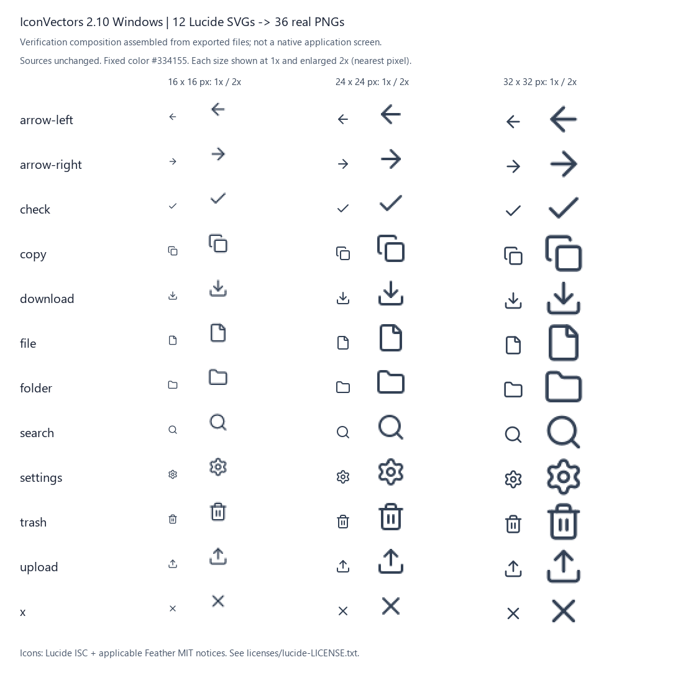

# Keep the SVG sources. Verify the PNG handoff.

Prepared for [axialis-software/iconvectors-svg-png-workflow](https://github.com/axialis-software/iconvectors-svg-png-workflow).

A small, inspectable asset-delivery example: **12 Lucide SVGs → 36 transparent PNGs at 16, 24 and 32 px**, exported with **IconVectors 2.10 for Windows**. The fixed-color PNGs are useful when a desktop or game UI needs explicit raster sizes while the themeable vector originals must remain available.

This repository contains example assets, documentation and a checker. **IconVectors is commercial, proprietary software, installed separately. Its application source code and executables are not included.** You do not need IconVectors to inspect the supplied files or run the checker. Repeating the export requires an appropriately licensed installation or trial from the [official download page](https://iconvectors.io/download.html).

## Inspect the actual outputs



This is a composed verification sheet, not an application screenshot. Each of the 36 actual outputs is shown at native size and enlarged 2× with nearest-neighbor scaling. Browser scaling may change the displayed pixel size; inspect the individual files at 100% too.

The [existing 5:2 composition](media/social-x-5x2.png) shows five representative icons at three sizes, with native copies and 4× pixel detail. Neither image was regenerated for this package.

[Watch or download the 52-second workflow video](docs/media/iconvectors-svg-to-png-52s.mp4) (MP4/H.264, 1280 ? 720, 30 fps, silent). It is an edited walkthrough using real application captures and existing output compositions, not an uninterrupted 52-second export benchmark. The supplied video is included without re-encoding. [Video contents and rights](docs/media/README.md).

## Files

- `source/`: twelve unchanged upstream Lucide SVGs.
- `png/`: the 36 original IconVectors exports, fixed color `#334155`.
- `source-manifest.json`: pinned upstream URLs, revision and SHA-256 hashes.
- `evidence/m14-results.csv`: original per-file validation results.
- `media/`: the two existing compositions above.
- `verify.py`: read-only, standard-library Python verification.
- `licenses/lucide-LICENSE.txt`: complete original ISC and applicable Feather MIT notices.
- `LICENSE` and `LICENSE-SCOPE.md`: MIT for original contributions, with separate third-party and product rights.
- `docs/media/`: the supplied 52-second video and its contents/rights notes.
- `package-manifest.json`: exact file inventory and hashes, excluding the manifest itself.

Icons: arrow-left, arrow-right, check, copy, download, file, folder, search, settings, trash, upload and x. `trash.svg` is the actual source; it is not renamed from `trash-2.svg`.

## Reproduce in IconVectors 2.10 Windows

1. Keep `source/` unchanged. Make a **new copy** of those twelve SVGs in a separate working folder. Use a new export folder too; do not overwrite the reference `png/` files.
2. Open the working folder in Icon Explorer, clear any filters and select exactly the twelve SVGs. Resolve any unsaved document before proceeding.
3. Run **Replace Colors**: replace symbolic `currentColor` with `#334155`, covering fill and stroke. Review the twelve selected targets before applying. In the tested output, fixed stroke styles override the root's `currentColor`; the text `currentColor` may still occur in the file. This is not a claim that every occurrence is removed.
4. Run **Make PNG, ICO Bitmap Icons**. Choose PNG only, sizes **16, 24, 32**, transparent background and explicit `currentColor` fallback `#334155`. Use the new destination, no custom suffix and no overwrite. Review the expected **36 outputs** and apply once.
5. Compare the output names with `png/`. Inspect each size at 100% on light and dark backgrounds. Check transparent background, visible content and edge coverage, not just whether a file exists.

The original run used the real application's batch operations through its local MCP interface. The recipe above describes the corresponding operations; this package does not automate the application or require MCP configuration. No new export was performed to prepare this repository. Results from another application version or rendering environment may differ; byte-identical re-exports are not promised.

## Verify the reference package independently

With Python 3.9 or later, from this directory:

```sh
python verify.py
```

No pip packages, network access, application installation or writes are required. Success prints `PASS`, twelve sources, 36 PNGs and the exceptional edge/opacity cases. A mismatch returns a nonzero exit code.

The checker verifies exact source and PNG hashes, the 12×3 filename mapping, PNG chunk CRCs, dimensions and decoded RGBA pixels against the original CSV. It checks transparent and painted pixels, alpha extrema, opaque-pixel color and alpha-weighted RGB error. It supports only the small, noninterlaced RGBA8 files in this corpus; it is not a general image decoder or an SVG renderer. Hashes establish identity to these reference files, not a new rendering or a visual-quality guarantee. Changing only the CSV cannot make a changed PNG agree with the reference manifest supplied with this package.

For your own rerun, keep these references intact. A hash difference is a difference to inspect, not proof of a rendering failure. This fixed-corpus script is not presented as a validator for arbitrary new exports.

## What the 16 px outputs teach us

- `copy`, `file`, `folder`, `settings` and `trash` have antialiased pixels at the 16 px image boundary (maximum edge alpha 55–109). The original visual review did not identify a visibly lost segment, but empty borders are not guaranteed.
- `arrow-left`, `arrow-right` and `check` at 16 px have **no fully opaque pixels**. Requiring at least one alpha-255 pixel would incorrectly fail these references. The opaque-color check is not applicable for those files.
- Where opaque pixels exist, RGB matches `#334155` within one level per channel. Translucent pixels may have rounded RGB values. The measured maximum alpha-weighted RGB error is about **1.521569 levels out of 255**, under the chosen tolerance of 2.

These are observed limits, not a claim of pixel-perfect rendering. Evaluate the smallest size in its actual UI context. Keep the vector originals for later size, color and theme changes.

## Provenance and rights

The source manifest pins Lucide revision `70562c1ee1c4fdcf736fe97bc893fb8511927934`. Source files and PNGs are copied byte-for-byte from the validated demonstration. All original Lucide and applicable Feather notices accompany the SVGs, derived PNGs and compositions. AXIALIS does not claim authorship of the icon drawings.

Original AXIALIS SA scripts, documentation and original composition/editing contributions are covered by the [MIT license](LICENSE), Copyright (c) 2026 AXIALIS SA. Third-party icon artwork and derivatives retain the complete [Lucide ISC and applicable Feather MIT notices](licenses/lucide-LICENSE.txt). Captured product UI and trademarks retain their own rights; IconVectors remains commercial proprietary software. See [LICENSE-SCOPE.md](LICENSE-SCOPE.md) for the file-level scope.

Prepared by Axialis. To explore the commercial workflow, see [IconVectors](https://iconvectors.io/) and its [Windows download page](https://iconvectors.io/download.html). There is no signup requirement for inspecting these reference assets.
